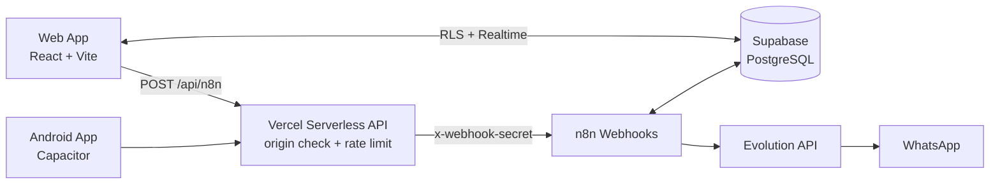

# MedFlow — Medical Center Management & Workflow Automation Platform

> Most businesses don't have a software problem. They have a disconnected-tools problem.

MedFlow is an integrated, Arabic-first (RTL) platform for a medical center: a public website, online booking, role-based patient / doctor / admin dashboards, an Android app, and an **n8n automation layer** that talks to patients on WhatsApp through the Evolution API.

The goal is not just a website or an app. It is one connected system where **Supabase is the single source of truth**, **n8n runs the operational workflows**, and **WhatsApp is the patient channel**.


---

## Project at a glance

| | |
|---|---|
| **Role** | Designed and built the automation layer, system integration and backend; contributed to the web and mobile apps |
| **Focus** | Automation engineering, API integration, database architecture |
| **Domain** | Healthcare operations (appointments, prescriptions, campaigns, reporting) |
| **Core stack** | n8n, Evolution API, Supabase / PostgreSQL, React, TypeScript, Capacitor |
| **Delivery** | Web app (Vercel) and Android app (Capacitor) on one shared backend |

### Engineering highlights

- **Event-driven automation:** 10 business events routed through a single secured proxy to dedicated n8n webhooks.
- **Failure isolation:** bookings succeed even when n8n is unavailable; notification state is reported, never rolled back.
- **Data integrity:** partial unique index prevents double-booking; atomic cancellation updates avoid race conditions.
- **Security by design:** role-based RLS, server-only secrets, database-enforced rate limiting, HMAC-hashed OTP codes.
- **One source of truth:** Supabase with Realtime on 13 tables keeps every dashboard in sync.

---

## Architecture



```text
Browser → POST /api/n8n → n8n Webhook (x-webhook-secret) → Evolution API → WhatsApp
```

The browser never receives the n8n secret or Evolution credentials. Notifications are failure-isolated: **a booking succeeds locally even if n8n is down**, and the UI reports the notification state without rolling anything back.

---

## What it automates

| Process | Event | n8n webhook path |
|---|---|---|
| Booking confirmation & reminders | `appointment.created`, `appointment.reminder` | `app-booking` |
| Cancellation notice | `appointment.cancelled` | `app-cancel-booking` |
| Rescheduling notice | `appointment.rebooked` | `app-Rebooking` |
| Prescription delivery on WhatsApp | `prescription.issued` | `app-Treatment` |
| Doctor unavailable → notify affected patients | `doctor.unavailable` | `app-not-available` |
| Promotional campaigns to patient lists | `offer.broadcast` | `app-offer` |
| Scheduled PDF reports | `report.send` | `app-report` |
| Review collection | `review.submitted` | `app-review` |
| Low-rating alert (rating ≤ 2) | `review.negative` | `app-review.negative` |
| Password-reset OTP over WhatsApp | `patient.password_reset` | `app-password-reset` |

Every path can be overridden with its `N8N_PATH_*` environment variable.

---

## Features

**Public website**
- Landing page, specialties, doctors, reviews, contact
- Four-step booking wizard: specialty → doctor → date/time → patient details

**Patient portal**
- Appointments, prescriptions, follow-ups, reviews, editable profile
- Prescription PDF / print and invoice printing

**Doctor portal**
- Today / upcoming schedule, patient files, appointment management
- Attendance, analytics, reviews
- Prescription-to-image WhatsApp flow
- Emergency cancellation flow ("عندي ظرف") that notifies affected patients

**Admin portal**
- Overview, activity log, doctor / schedule / attendance management
- Appointments, WhatsApp conversations, reports, campaigns, reviews, center settings

**Platform**
- Live data through Supabase Realtime on 13 tables
- Strict writes for bookings, prescriptions and reviews; retry queue only for low-stakes rows
- Double-booking prevention with a partial unique index (a cancelled slot can be reused)
- Egypt + Gulf phone normalization, identical on client and server

---

## Tech stack

| Layer | Technologies |
|---|---|
| Automation & integration | n8n, Evolution API, WhatsApp, REST APIs, Webhooks |
| Backend & database | Supabase, PostgreSQL (RLS, RPC, triggers, Realtime), Vercel serverless functions (Node.js 20) |
| Frontend | React 19, TypeScript (strict), Vite 7, Tailwind CSS v4, React Router v7, Framer Motion |
| Mobile | Capacitor 7 (Android) |
| Documents | html2canvas, jsPDF |

---

## Project structure

```text
├── api/                    Vercel serverless functions
│   ├── n8n.js              Notification proxy (allowlist, rate limit)
│   ├── cancel-booking.js   Atomic cancellation
│   ├── password-reset.js   OTP reset over WhatsApp
│   └── _lib/               n8n client, phone rules, rate limit, Supabase
├── n8n/                    Importable starter workflow
├── supabase/migrations/    Schema, RLS policies, RPC functions
├── src/
│   ├── pages/              Landing, Book, Auth, Doctors, Reviews, Contact
│   ├── dashboards/         Patient, Doctor, Admin
│   ├── components/         Shared UI
│   └── lib/                Supabase client, phone, PDF, n8n helpers
├── resources/              Android icons and splash
└── capacitor.config.json
```

---

## Getting started

**Requirements:** Node.js ≥ 20, a Supabase project, an n8n instance, an Evolution API instance.

```bash
npm install
cp .env.example .env.local
npm run dev
```

Production check:

```bash
npm run typecheck
npm run build
npm run preview
```

### Environment variables

```dotenv
# Browser (public)
VITE_SUPABASE_URL=https://your-project.supabase.co
VITE_SUPABASE_PUBLISHABLE_KEY=sb_publishable_your_key
VITE_API_BASE=                 # Android build only: your deployed site URL

# Server only (never use a VITE_ prefix)
SUPABASE_URL=https://your-project.supabase.co
SUPABASE_SERVICE_ROLE_KEY=your_service_role_key
N8N_WEBHOOK_BASE=https://n8n.example.com/webhook
N8N_WEBHOOK_SECRET=replace_with_a_long_random_secret
PASSWORD_RESET_SECRET=replace_with_another_long_random_secret
DEFAULT_GULF_CC=966
```

### Database

1. Run `supabase/migrations/202611150001_medflow_schema.sql` once.
2. Add `medflow` under **Project Settings → API → Exposed schemas**.

Everything lives in the `medflow` schema, so it is safe to share a Supabase project with other apps. The migration creates appointments, patients, profiles, doctor schedules / attendance / leaves, offer campaigns and recipients, rate limiting (`rate_hit` RPC), cancellations with a status-change trigger, server-only password resets, RLS policies, and Realtime publication entries.

### Create the first admin

Create a user in **Supabase → Authentication → Users** (or via `/register`), then promote it:

```sql
update medflow.profiles set role = 'admin'
where email = 'you@example.com';

update medflow.profiles set role = 'doctor', doctor_id = 'd1'
where email = 'doctor@example.com';
```

### n8n setup

1. Import `n8n/medflow-whatsapp.json`.
2. Create a **Header Auth** credential: name `x-webhook-secret`, value equal to `N8N_WEBHOOK_SECRET`.
3. Fill in your Evolution API host, instance name and API key.
4. Duplicate the workflow for each webhook path in the table above.

In n8n the request body is under `$json.body` (for example `$json.body.event`, `$json.body.payload.phone_wa`). End every workflow with a **Respond to Webhook** node, otherwise the API reports a `502` after 12 seconds.

---

## Server APIs

| Endpoint | Purpose | Protections |
|---|---|---|
| `POST /api/n8n` | Forward events to n8n | Same-origin only, event allowlist, 4.2 MB body cap, 120 req / 10 min / IP |
| `POST /api/cancel-booking` | Atomic booking cancellation | Same-origin, 20 req / 10 min / IP, phone must match the booking, rejects completed or past bookings (`409`) |
| `POST /api/password-reset` | OTP reset over WhatsApp | 6-digit code, 10 min expiry, 5 attempts, 60 s cooldown, HMAC digest only stored, `timingSafeEqual` check |

Example:

```bash
curl -i http://localhost:5173/api/n8n \
  -H 'Content-Type: application/json' \
  -H 'Origin: http://localhost:5173' \
  -d '{"event":"appointment.created","payload":{"appointment_id":"apt_test","phone":"966501234567"}}'
```

---

## Security model

- Role-based RLS: staff see everything, patients see only their own appointments and prescriptions, the public sees only doctors, specialties, offers, schedules, reviews and center info.
- Taken time slots are exposed through a public `booked_slots()` RPC that returns **no patient data**.
- Service-role key, n8n secret and reset secret are server-only.
- Rate limiting is enforced in the database (`rate_hit`), not in memory.
- Password-reset codes are stored as HMAC digests, never in plain text.

---

## Deployment

`vercel.json` builds the Vite SPA, rewrites non-`/api` routes to `index.html`, and deploys `api/**/*.js` as Node.js 20 functions.

```bash
npm run build
npx vercel --prod
```

Add the environment variables in the Vercel project settings.

### Android

```bash
npm run cap:sync    # build + sync web assets
npm run cap:open    # open in Android Studio
```

---

## About the author

**Faris Ataa Lashen** — AI Automation Engineer

I build reliable automation systems that remove repetitive work and connect the tools a business already uses. Current focus: n8n, API integrations, AI agents and agentic workflows.

**Connect**

- LinkedIn: [linkedin.com/in/YOUR-USERNAME](https://www.linkedin.com/in/YOUR-USERNAME)
- GitHub: [github.com/YOUR-USERNAME](https://github.com/YOUR-USERNAME)
- Email: your.email@example.com

Open to Junior AI Automation Developer and AI Engineer opportunities.

## License

See [LICENSE](LICENSE).
